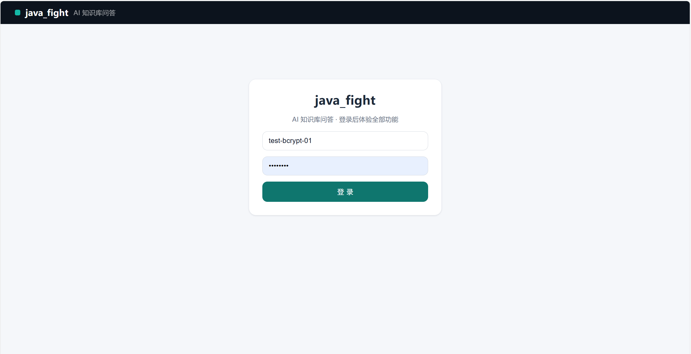
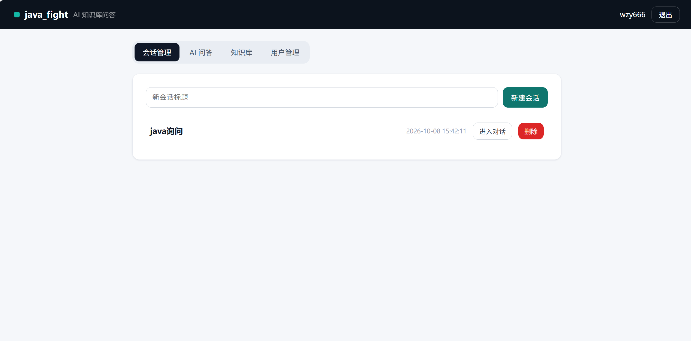
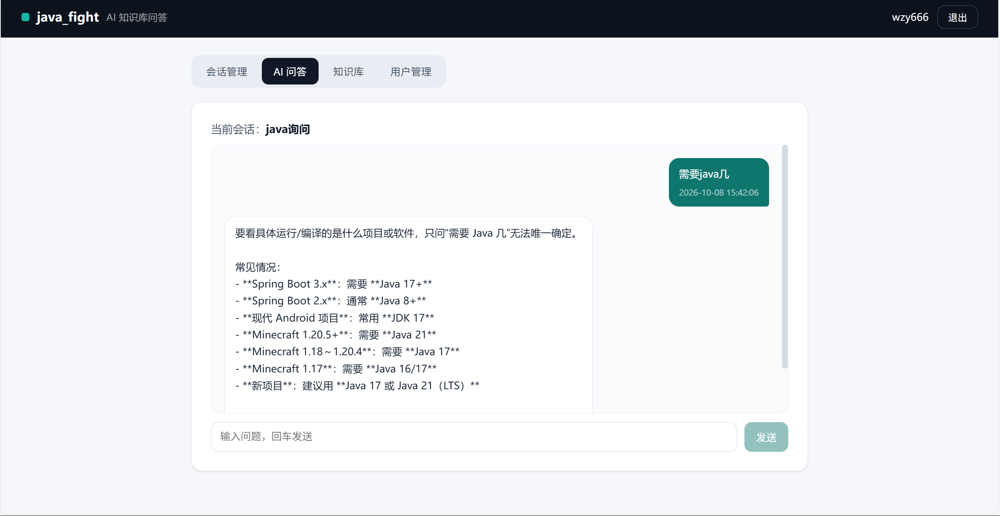
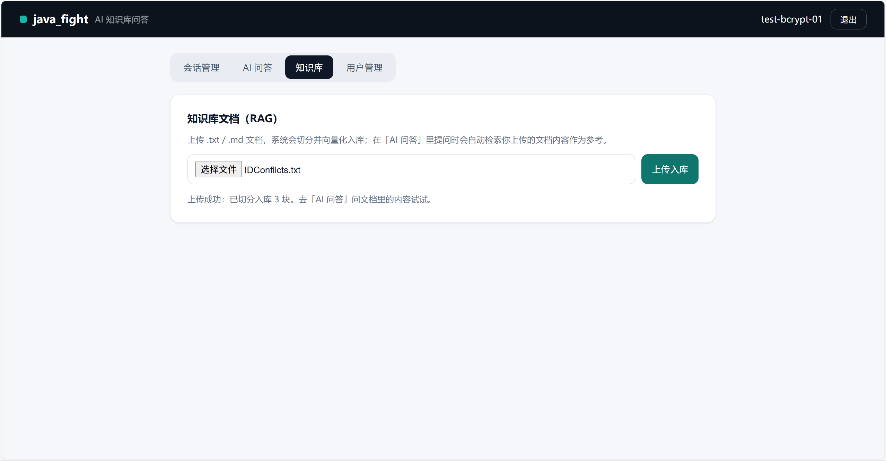
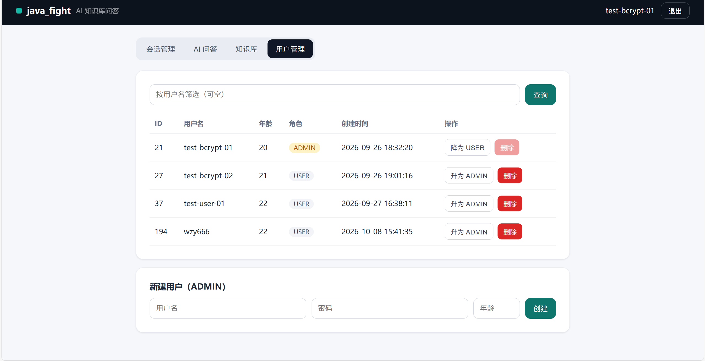

# java_fight

一个以「登录 → 会话 → AI 问答」为主线的 Java 后端项目，重点在后端工程化：JWT 鉴权、Redis 缓存治理、接口限流、事务边界，以及一版接上 Spring AI 的 RAG 问答——多轮记忆、向量检索、工具调用、结构化输出四件能力都落在 `/chat` 上。

## 技术栈

- Java 21 / Spring Boot 4.1（Spring Framework 7，Jakarta 包名）
- MyBatis + MySQL 8（四张表：用户 / 会话 / 消息 / 文档块）
- Redis（`StringRedisTemplate`，缓存与互斥锁）
- Spring AI 2.0.1：DeepSeek 负责对话，Ollama 本地跑 embedding（`qwen3-embedding:0.6b`，1024 维）
- Docker / Docker Compose 一键部署

## 功能

- **登录鉴权**：登录签发 JWT，拦截器统一校验；账号由管理员接口创建，无自助注册
- **会话管理**：会话与消息持久化，历史可回看
- **AI 问答**：`/chat` 接 DeepSeek，带超时与重试；多轮上下文由 `ChatMemory` 承载，历史持久化
- **RAG**：文档上传 → 切块 → 本地 embedding 入库 → 检索增强。检索挂在 `/chat` 的 advisor 上，按 `user_id` 圈定范围，引用块号按本轮真实命中集校验
- **文档上传异步化**：上传接口立刻返回，向量化交给后台线程池。瓶颈本是 80 个分块逐块算 embedding，接口耗时从 57.6s 降到 0.196s
- **工具调用**：模型可自行调用 `listMyDocs` 查当前用户名下的文档
- **结构化输出**：回答以 `{answer, citedIds}` 返回，不再靠解析自由文本

## 后端要点

- **事务边界**：外部模型调用整体移出数据库事务——用户消息先提交，AI 调用回来再开一段短事务落回执，避免长耗时请求占住连接池把整站拖死
- **advisor 顺序**：记忆先跑、检索后跑。检索只改「要发出去那一份」user 消息副本，不回写记忆——否则历史里会攒下一堆带着检索上下文的假问题
- **缓存治理**：空值哨兵防穿透、`setIfAbsent` 互斥锁防击穿（实测 100 并发 → 1 条 SQL）、`afterCommit` 删缓存，避开「删了又被旧事务写回」的脏窗口
- **越权校验**：角色看 token、归属查库，删除他人会话返回 403
- **登录限流**：失败计数落在 Service 层（拦截器覆盖不到，原因见代码注释）
- **统一结果封装**：`code=1` 成功 / `code=0` 失败

## 已知取舍

- 向量库用的是 Spring AI 的内存实现 `SimpleVectorStore`，重启后要重新装载并计算 embedding。选它是因为项目规模小、也不想为一个可丢弃的检索副本再引一个中间件；将来换 Redis 或 pgvector，只需替换 `VectorStore` 的实现。
- 结构化输出和记忆并存时，写进 `ChatMemory` 的 assistant 消息是模型返回的**原始 JSON**，不是清洗后的 `answer` 字段。功能上不受影响，只是历史记录不够干净。

## 演示页面

单文件 HTML + Vue 3（CDN），与后端打在同一个 jar（`src/main/resources/static/`），同源访问，无需 CORS 配置。覆盖登录、会话管理、AI 问答、知识库（RAG）、用户管理。

**登录**



**AI 问答（多轮上下文，历史持久化）**



**会话管理**



**知识库（RAG）：上传文档切分入库，问答时自动检索参考**



**用户管理：分页查询（动态 SQL）、角色调整、新建用户（ADMIN）**



## 快速启动

需要先设置三个环境变量（只有变量名，不含值）：`DB_PASSWORD`、`JWT_SECRET`、`DEEPSEEK_API_KEY`。详细步骤与排障见 [DEPLOY.md](DEPLOY.md)。

容器方式（推荐，MySQL + Redis + 应用一起起）：

```bash
docker compose up -d --build
```

应用起来后访问 `http://localhost:8080/index.html` 即演示页。AI 问答的 embedding 依赖宿主机 Ollama（`qwen3-embedding:0.6b` 模型，需自行 `ollama pull` 并关掉 Vulkan 后端）。`db/init.sql` 预置了三个演示账号，可直接登录演示页，见 DEPLOY.md 第六节。

## 项目结构

```
src/main/java/        业务代码（controller / service / mapper / ai / config / dto / vo / pojo）
src/main/resources/   配置、Mapper XML 与静态页（static/index.html）
db/init.sql           建表 + 演示账号初始化
docs/                 README 里的演示截图
Dockerfile            单阶段构建
docker-compose.yml    mysql + redis + app 三服务
DEPLOY.md             部署步骤与排障
```
